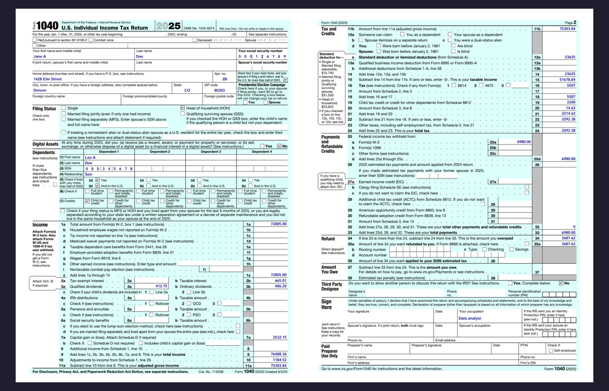
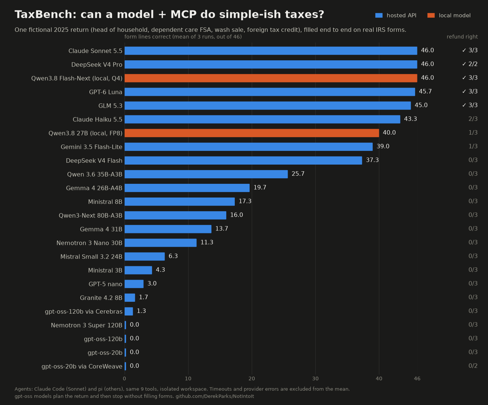
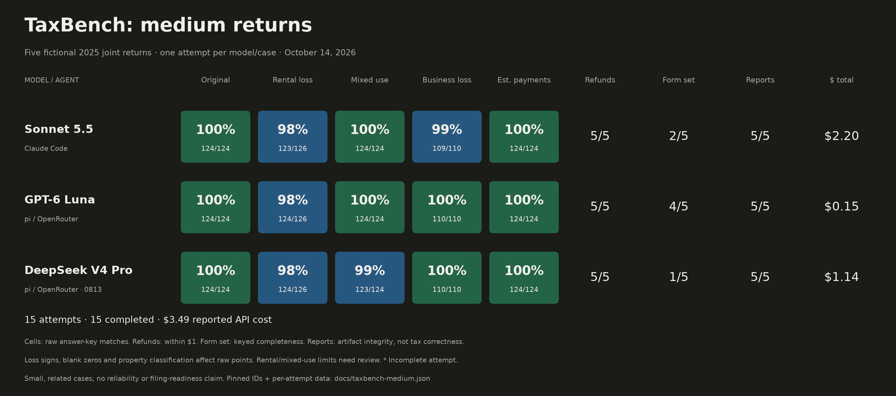

# NotIntoIt

<p align="center"></p>

> [!WARNING]
> **NotIntoIt is a proof of concept, not tax software, and not tax advice.**
> AI models make mistakes, including ones that change what you owe. Review
> every form it fills against your documents and the IRS instructions before
> you sign or file anything. You are solely responsible for what you send to
> the IRS. NotIntoIt never e-files.

LLM-assisted tax prep for people who are not into it. NotIntoIt is an MCP
server that gives an AI assistant what it needs to prepare a US federal return
on real IRS forms: it reads your documents, fetches and fills the actual
irs.gov PDFs, shows you the result, computes the form-line arithmetic, and grounds its
answers in the Internal Revenue Code and the IRS's own instructions.


*Claude Sonnet prepares [Jane Doe's](examples/jane-doe) 2025 return from her
W-2, 1099s, and notes: seven forms, about 25 tool calls, two minutes (sped up
4× in the middle). The result:*

[](docs/filled-1040.png)

You get filled PDFs to review, print, and file yourself. Tax data you share
with an assistant goes to that assistant's model provider (or stays on your
machine with a local model); everything else runs locally.

## Status

Working end to end for tax year 2025 (and 2024 tax computation). Claude Sonnet
prepares the [example taxpayer's](examples/jane-doe) complete return —
Form 1040 with Schedules 1, 3, D, 8812 and Forms 8949 and 2441 — at 46/46
on [TaxBench](#taxbench), and so do cheaper hosted, open-weights, and local models. Not yet: state returns, and scanned documents beyond
what a vision model can read.

## Install

Linux and macOS:

```sh
curl -LsSf https://github.com/DerekParks/NotIntoIt/releases/latest/download/nii-installer.sh | sh
```

Windows (PowerShell):

```powershell
powershell -ExecutionPolicy Bypass -c "irm https://github.com/DerekParks/NotIntoIt/releases/latest/download/nii-installer.ps1 | iex"
```


Prebuilt for Linux x86_64 and arm64 (glibc 2.38+, e.g. Ubuntu 24.04), macOS
on Apple Silicon, and Windows x86_64 (needs the Visual C++ runtime); archives
are on the [releases page](https://github.com/DerekParks/NotIntoIt/releases).
Elsewhere, build from source with Rust 1.89+:

```sh
cargo install --git https://github.com/DerekParks/NotIntoIt nii --locked
```

Either way you get one binary, `nii`. It is self-contained apart from pdfium,
which it downloads on first use.

## Use it from an assistant (MCP)

Claude Code:

```sh
claude mcp add --scope user notintoit -- nii mcp
```

Claude Desktop — add to `claude_desktop_config.json` (use the absolute path
from `which nii`):

```json
{
  "mcpServers": {
    "notintoit": { "command": "/home/you/.cargo/bin/nii", "args": ["mcp"] }
  }
}
```

Any MCP client works the same way. Put your documents in
`~/Taxes/2025/` and ask something like *"Prepare my 2025 federal return from
the documents in my tax workspace."*

### Guided tax interview

Use the bundled `tax-wizard` prompt to work through household details, income,
deductions, credits and payments. It reads existing documents first and asks
about missing facts, including side-business and rental details.

With the server registered as `notintoit`, start it in Claude Code with:

```text
/mcp__notintoit__tax-wizard 2025
```

Other clients expose it through their MCP prompt picker. Progress stays in the
conversation. The [interview instructions](apps/cli/prompts/tax-wizard.md) are
embedded in the binary; no separate skill installation is needed.

### Tools

| tool | what it does |
|---|---|
| `list_documents` / `read_document` | Lists workspace files and reads PDF text, notes and CSVs. |
| `fetch_irs_form` | Downloads the requested year's IRS form, preserving existing working copies by default. |
| `get_form_instructions` | Fetches exact-year IRS instructions; navigate by page or search. |
| `list_form_fields` | Lists editable fields, IRS descriptions, types and current values. |
| `fill_form` | Fills fields, reports rejected values and supports unambiguous abbreviated names. |
| `view_pdf` | Renders completed pages and optionally opens a PDF viewer. |
| `validate_return` | Checks supported 2025 forms for identity, arithmetic, transfers and W-2 ownership errors. |
| `create_review_report` | Saves validation findings, file hashes and recorded IRS source access as JSON and Markdown. |
| `calculate` | Evaluates form-line arithmetic with explicit rounding. |
| `compute_tax` | Computes Form 1040 line 16 for supported 2024/2025 worksheets. |
| `search_tax_law` | Searches Title 26 and IRS guidance, flagging mismatched or unknown tax-year editions. |

Every tool stays inside the tax workspace: documents are read from it, forms and instructions are fetched into it, and PDF tools refuse paths outside it.

`get_form_instructions` accepts a form, tax year and optional page or search:
`{"form":"Schedule SE","tax_year":2025,"search":"line 8a"}`.
See the [mapping catalog](apps/cli/instruction-mappings.tsv) and
[audit results](apps/cli/tests/fixtures/irs-instruction-audit.json) for coverage.
Unavailable exact-year instructions return an explicit lookup error.

### First run

On startup the server downloads the prebuilt search index for its version from
the GitHub release (about 10 MB, checksum-verified; ready in seconds) and the
local embedding model it uses for queries (65 MB). If the download isn't
available, it builds the index itself instead: it fetches Title 26 from
uscode.house.gov and the IRS instructions and publications, then embeds about
15k chunks on your CPU (roughly 20 minutes). `search_tax_law` reports progress
until the index is ready; the other tools work immediately, and a failed build
retries on its own. `nii corpus fetch` and `nii corpus build` do the same from
the command line; `NII_INDEX_URL=none` skips the download.

## Where things live

| | default | override |
|---|---|---|
| tax workspace (your documents and forms) | `~/Taxes` | `--workspace` / `NII_WORKSPACE` |
| caches, model, index, pdfium | platform data dir (`~/.local/share/notintoit`, `~/Library/Application Support/notintoit`) | `--data-dir` / `NII_DATA_DIR` |
| whether `view_pdf` may open your PDF viewer | yes | `NII_NO_VIEWER=1` turns it off (headless and sandboxed servers) |

## CLI

Everything the MCP server does is also a command:

```sh
nii form fetch 1040 --year 2025               # prints the working copy's path
nii form fields ~/Taxes/2025/forms/f1040.pdf --page 1
nii form fill ~/Taxes/2025/forms/f1040.pdf --values answers.json
nii form view ~/Taxes/2025/forms/f1040.pdf    # opens your viewer; --png out.png to render
nii form flatten f1040.pdf --output print.pdf # burn values into the page for printing
nii corpus build                              # build the search index in the foreground
nii search "home office deduction"
```

## TaxBench

Agents prepare fictional returns in isolated workspaces using only NotIntoIt's
MCP tools. The grader checks the filled IRS PDFs against case answer keys.

### Simple return

[Jane Doe](examples/jane-doe): a single parent with wages, dependent care,
savings interest and a brokerage wash sale. Three runs per model where completed;
timeouts and provider errors are excluded from the means.



### Medium returns

Five joint-return cases: side business, rental loss, mixed use, business loss
and estimated payments. One attempt per model per case.



- All three models got **5/5 refunds within $1**.
- Total reported cost: **Luna $0.15 · DeepSeek $1.14 · Sonnet $2.20**.
- Raw field scores include formatting/classification mismatches. Report integrity
  does not certify tax correctness; rental-loss and mixed-use limits need review.

[Model card and data](bench/MEDIUM_MODEL_CARD.md) · [Case definitions](bench/medium-variants.md)

### Run a benchmark

```sh
python3 bench/run.py medium --agent pi --model openrouter/openai/gpt-6-luna --runs 1
python3 bench/report.py medium --markdown
```

Agents: Claude Code (`--agent claude`), pi (`--agent pi`) and Gemini CLI
(`--agent gemini`). PDFs, transcripts and grades go to `bench/runs/` (ignored by
Git). Costs and results vary between attempts.

## Development

```sh
cargo test --workspace     # unit tests; the PDF tests download pdfium on first run
cargo clippy --workspace --all-targets
cargo fmt --all
```

Releasing: bump `version` in `Cargo.toml`, tag `vX.Y.Z`, and push the tag; the
release workflow builds and publishes the binaries. Then attach the index the
new version will download:

```sh
nii corpus build && nii corpus pack
gh release upload vX.Y.Z target/index-release/nii-index.db.zst target/index-release/nii-index.db.zst.sha256
```

| path | what |
|---|---|
| `apps/cli` | `nii`: the CLI and MCP server |
| `crates/pdf` | form download, field listing (XFA descriptions), filling with generated appearances, rendering, flattening |
| `crates/core` | shared types, `calculate`, and the line 16 tax computation |
| `crates/corpus` | Title 26 USLM parsing (with amendment caveats) and IRS HTML guidance chunking |
| `crates/embed`, `crates/search` | local embeddings and the SQLite FTS5 + sqlite-vec hybrid index |
| `bench/` | TaxBench harness, grader, and cases |
| `examples/medium` | the fictional family, freelance-business and rental source packet |
| `examples/jane-doe` | the example taxpayer and the script that generates her documents |
| `spikes/` | early de-risking spikes ([SPIKES.md](SPIKES.md)) |
